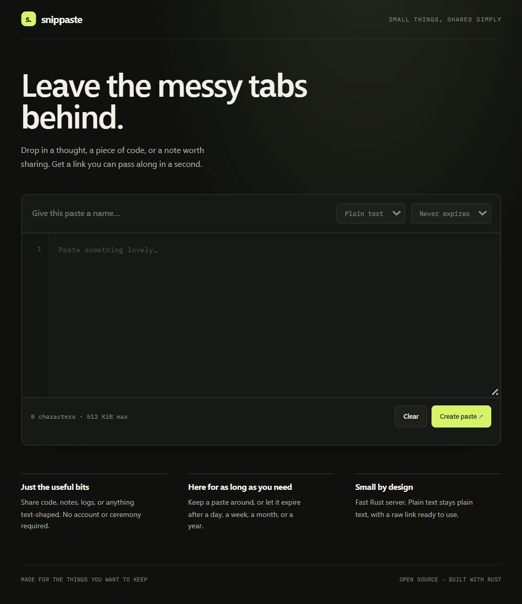
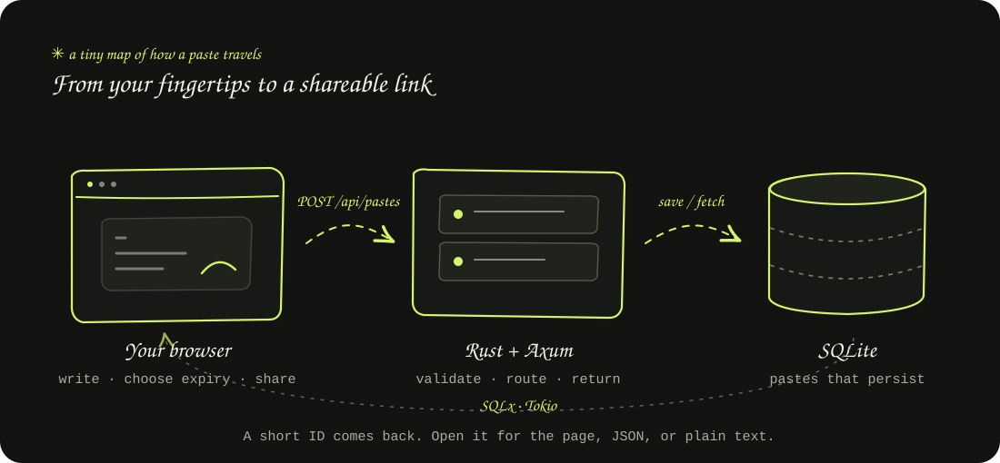

<div align="center">

# SnipPaste

### A little corner of the internet for the things you want to share.

Drop a thought. Keep a snippet. Send a link.

<p>
  
  
  
</p>

**No account. No clutter. Just a clean paste and a link.**

</div>

SnipPaste is a self-hosted pastebin for code, notes, logs, and other text-shaped treasures. It pairs a calm, dark interface with a small Rust web server and SQLite storage. Pasting something should feel like setting down a book on a tidy desk: easy, quiet, and ready to pick up again.

## A peek inside

<div align="center">
  
  <br>
  <sub>Live app screenshot · home page and paste composer</sub>
</div>

## What makes it nice

- **A link in a moment** — create a paste without making an account.
- **Your choice of shelf life** — keep it forever or let it expire after a day, a week, a month, or a year.
- **A proper raw view** — grab plain UTF-8 text at `/your-id/raw`.
- **Little language labels** — label snippets without shipping a bulky syntax-highlighting bundle.
- **A small, sturdy home** — SQLite saves pastes across restarts.
- **Made to be hosted by you** — one Rust service, one database file, and a tiny embedded page.

## Start your own SnipPaste

### 1 · Get the project

Download this project, or clone your copy of the repository, then open a terminal in its folder:

```bash
git clone <your-repository-url> SnipPaste
cd SnipPaste
```

### 2 · Make sure Rust is ready

SnipPaste uses the stable Rust toolchain and Cargo. Install them with [rustup](https://rustup.rs/) if you don't have them yet.

### 3 · Let it bloom

```bash
cargo run --release
```

The first run creates `data/snippaste.db` automatically. Once you see the listening address in the terminal, visit **http://127.0.0.1:3000**.

> **Windows note:** If Windows blocks a generated Rust build script with “An Application Control policy has blocked this file” (error 4551), the block is coming from Windows security policy. Try `cargo run` again; if it keeps happening, use the Docker option below or build in WSL.

### Or, the Docker way

With Docker Desktop running:

```bash
docker build -t snippaste .
docker run --rm -p 3000:3000 -v snippaste-data:/data snippaste
```

The named volume keeps your pastes safe between container restarts. Open **http://127.0.0.1:3000** and say hello.

## Make it yours

SnipPaste reads configuration from environment variables. `.env.example` is a handy reference; the app does not load `.env` files automatically.

| Setting | Default | What it changes |
| --- | --- | --- |
| `HOST` | `127.0.0.1` | Listening interface. Set to `0.0.0.0` in Docker or to accept other machines. |
| `PORT` | `3000` | The port to listen on. |
| `DATABASE_URL` | `sqlite://data/snippaste.db` | Where the SQLite database lives. |
| `MAX_PASTE_BYTES` | `524288` | Maximum paste size (512 KiB). |
| `PUBLIC_URL` | unset | Public origin, such as `https://paste.example.com`, for absolute links. |
| `RUST_LOG` | `snippaste=info,tower_http=info` | Logging detail. |

PowerShell example:

```powershell
$env:PORT = "8080"
$env:PUBLIC_URL = "https://paste.example.com"
cargo run --release
```

## The little blueprint

<div align="center">
  
</div>

The browser sends a paste to the Axum routes. The Rust service validates it, gives it a short ID, and stores it in SQLite through SQLx. Later, the same service returns a readable page, JSON, or plain text. Expiration is checked when a paste is read, so expired links go quiet right away.

## Routes for curious hands

| Route | What you'll find |
| --- | --- |
| `GET /` | The SnipPaste home and composer |
| `POST /api/pastes` | Create a paste from JSON |
| `GET /:id` | A readable paste page |
| `GET /api/pastes/:id` | Paste metadata and content as JSON |
| `GET /:id/raw` | Plain text for scripts, terminals, and copy-paste |
| Any unknown page | A branded 404 with a link back home |

Example create request:

```json
{
  "title": "A tiny Rust example",
  "content": "fn main() { println!(\"hello\"); }",
  "language": "Rust",
  "expiration": "30d"
}
```

`title` and `language` are optional. `expiration` accepts `never`, `1d`, `7d`, `30d`, or `1y`; it defaults to `never`.

## Libraries in the mix

| Library | Job |
| --- | --- |
| [Axum](https://crates.io/crates/axum) | HTTP routes and JSON request/response handling |
| [Tokio](https://crates.io/crates/tokio) | Async runtime and TCP listener |
| [SQLx](https://crates.io/crates/sqlx) | Async SQLite connections and queries |
| [Serde](https://crates.io/crates/serde) + [Serde JSON](https://crates.io/crates/serde_json) | JSON input, output, and safe page data serialization |
| [Chrono](https://crates.io/crates/chrono) | UTC timestamps and expiration dates |
| [Rand](https://crates.io/crates/rand) | Short, random paste IDs |
| [Tower HTTP](https://crates.io/crates/tower-http) | Request tracing and body-size limits |
| [Tracing](https://crates.io/crates/tracing) + [Tracing Subscriber](https://crates.io/crates/tracing-subscriber) | Structured server logs |

The interface is plain HTML, CSS, and JavaScript embedded into the server at compile time. IBM Plex Sans and IBM Plex Mono are served locally, so the interface does not need a third-party font request.

## Project map

```text
SnipPaste/
├── src/main.rs                 # Rust server, routes, and SQLite access
├── static/index.html           # Embedded interface
├── static/404.html             # Branded not-found page
├── docs/assets/
│   ├── snippaste-screenshot.png # Screenshot captured from the running app
│   └── architecture.svg        # Hand-drawn architecture sketch
├── Cargo.toml                  # Package and library manifest
├── Cargo.lock                  # Reproducible dependency versions
├── Dockerfile                  # Multi-stage container build
├── .env.example                # Configuration reference
├── .gitignore                  # Rust, database, and local editor files
└── LICENSE                     # MIT license
```

## A small hosting note

Anyone who can reach your instance can create and read pastes. There are no accounts or private pastes, so put it behind HTTPS before making it public. Back up the SQLite file (or your Docker volume) to keep your snippets safe. Expired pastes become unreadable immediately and can be removed from the database during maintenance.

## ⭐ Leave a Star

If SnipPaste made sharing a little nicer, leave a ⭐ on the repository and help this tiny project find its people.

## License

SnipPaste is shared under the [MIT License](LICENSE).

<div align="center">

### Made with care by **ashyyhere** ✿

</div>
